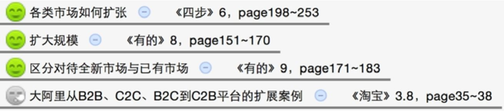
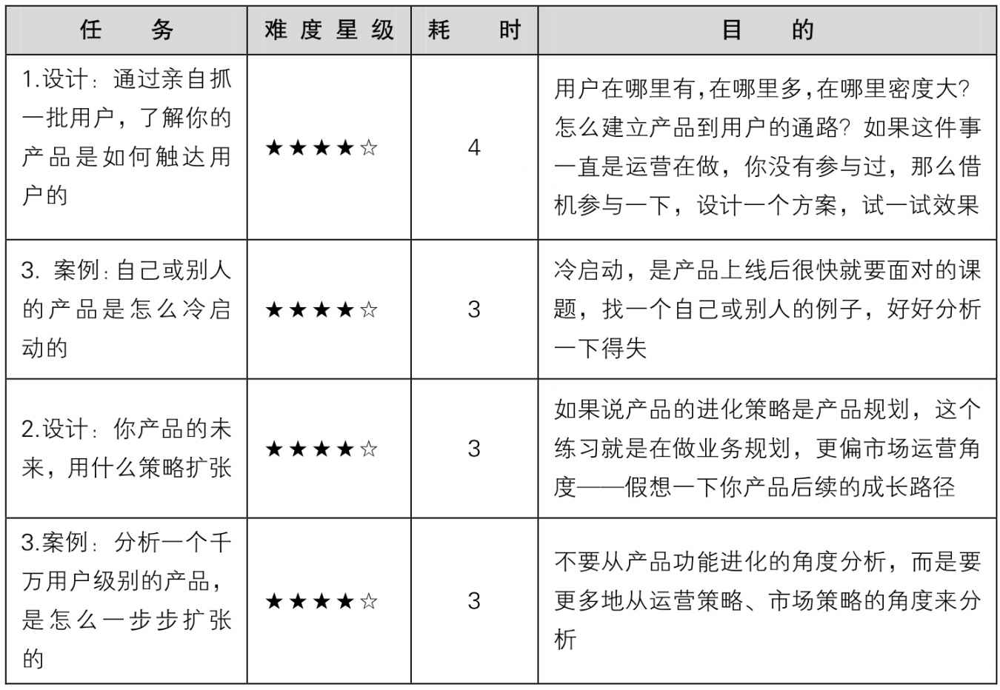
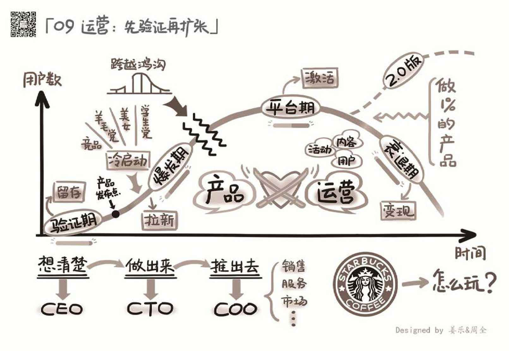

## 9.5　延伸阅读与练习

本章关联到另外几本书的相关章节如下。其中的图标表示推荐阅读（笑脸）与选择阅读（冷漠脸），亦可根据一些关键词扩展阅读。

以下为运营与销售部分：

<figure markdown="1">

{ width="353" height="121" }

</figure>

以下为市场与品牌部分：

<figure markdown="1">

{ width="552" height="120" }

</figure>

可以做的练习任务如下。

<figure markdown="1">

{ width="623" height="427" }

</figure>

<figure markdown="1">

{ width="824" height="569" }

</figure>

---

[[1]](../01/index.md#footnote_quote_txt010_1)
前百度产品副总裁，2017年担任滴滴产品负责人，业内著名的产品前辈。

[[2]](../02/01.md#footnote_quote_txt010_2)
“幂次法则”也叫“80/20法则”，由经济学家维尔弗雷多·帕累托在1906年提出。他认为，在任何一组事物中，最重要的只占其中一小部分，约20%，其余80%尽管是多数，却是次要的。

[[3]](../02/01.md#footnote_quote_txt010_3)
Acquisition（获取用户）、Activation（提高活跃度）、Retention（提高留存率）、Revenue（获取收入）、Refer（自传播），是产品运营工作的5个重要部分，AARRR是这5个单词的首字母缩写。此模型被硅谷产品运营圈广泛使用，是一个获取业务增长的方法论集合，俗称“海盗模型”。

[[4]](../02/01.md#footnote_quote_txt010_4)
网址bilibili.com，中文站名哔哩哔哩，是国内知名的视频弹幕网站。

