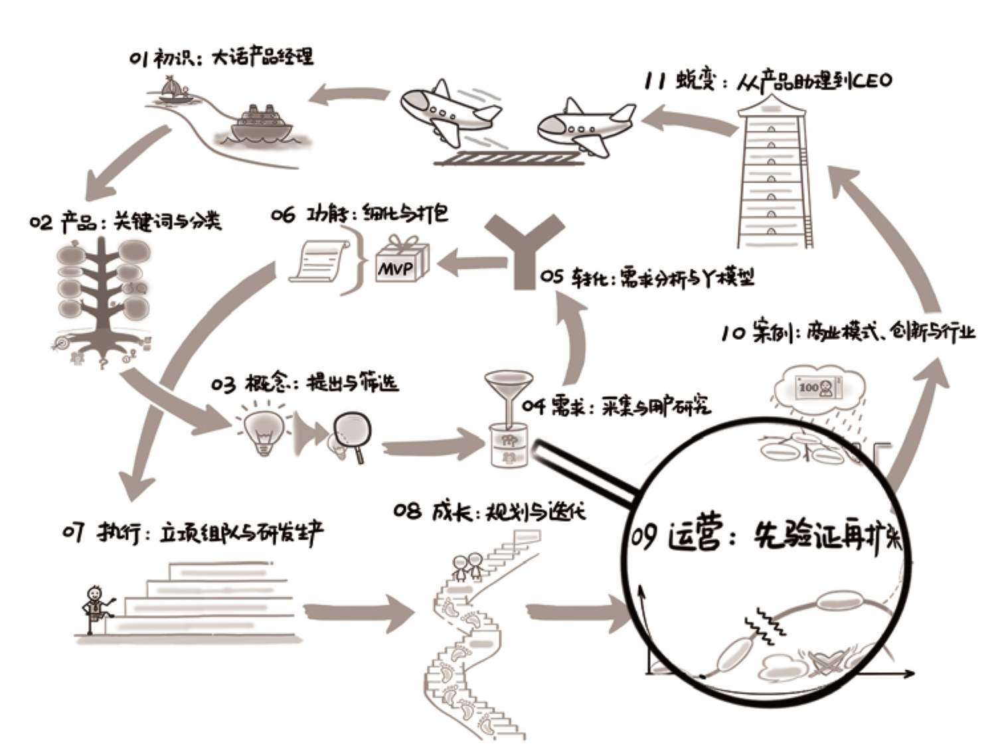

## 第09章　运营：先验证再扩张

{ width="633" height="473" }

**第09章　运营：先验证再扩张/249**

**9.1　产品与运营的关系/251**

9.1.1　需求、功能到卖点/252

9.1.2　多相爱，少相杀/253

9.1.3　给运营提需求的模板/255

**9.2　运营工作的分类/256**

9.2.1　不同阶段的运营目标/257

9.2.2　综合案例：星巴克/265

**9.3　大运营的其他职责/268**

9.3.1　产品与销售的关系/268

9.3.2　服务是广义的用户运营/269

9.3.3　市场的几种分类维度/270

9.3.4　品牌到底是什么/271

9.3.5　公关是企业的戾气与利器/272

**9.4　产品的生命周期/272**

**9.5　延伸阅读与练习/274**

