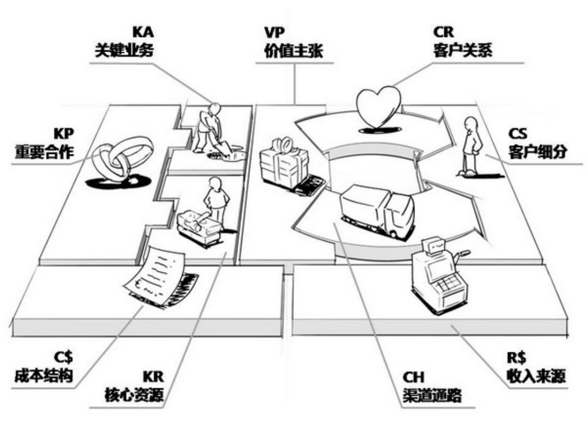
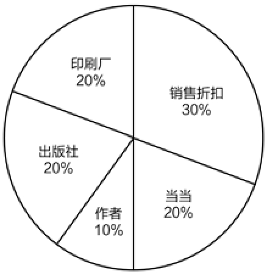
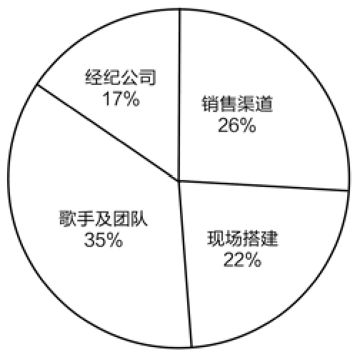
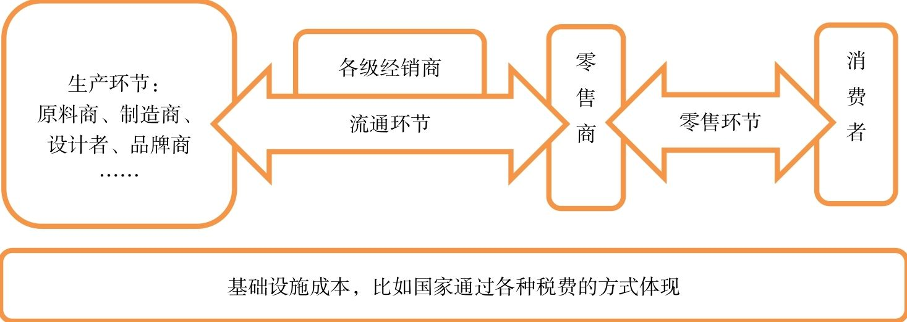

## 10.1　聊聊商业模式

这一章比较综合，会把第02到09章涉及的内容串起来讲。首先提一个“商业模式画布”（如[图10-1](#figure-10-1)）的概念，它有九个要素，覆盖非常全面。理解透这一概念，也就想清楚了完整的商业闭环。

<figure id="figure-10-1" tabindex="-1" markdown="1">

{ width="472" height="354" }

<figcaption markdown="span" style="margin:0.5em auto;font-size:0.8em;font-style:normal;line-height:1.5">
图10-1　商业模式画布
</figcaption>

</figure>

下面，用产品视角来重新解读一下这些要素。

►客户细分：我们的目标用户是谁，其中最重要的又是谁。

►价值主张：我们可以帮用户创造什么额外的价值。这里所说的价值必须是现有产品服务没有的，比如更高的性能、更低的价格、更小的风险。

►客户关系：用户与我们、用户与用户之间的互动模式是什么，比如专人一对一服务、用户自助使用、用户彼此共建社区，等等。

►渠道通路：如何与用户建立起高效联系，拉近现实与心理的距离。

►关键业务：我们需要做什么产品来解决用户问题，创造价值。

►核心资源：我们做这件事，和别人相比，有什么特别的优势因素。

►重要合作：我们需要和哪些上下游、周边伙伴协作，以及如何协作。

►收入来源：如何从用户那里获得收入，以维持业务可持续发展。

►成本结构：做这件事，都在哪些环节需要花钱。

如果想了解更多，推荐大家看《商业模式新生代》以及《商业模式新生代·个人篇》。

### 10.1.1 　对比：商业、业务、盈利模式

我们经常听到三个有关模式的词：商业模式、业务模式、盈利模式，听起来好像差不多，实则不然，让我们结合商业模式画布来区分一下。

►商业模式：完整讲述了我们创造了什么价值，为什么有存在的意义，对应[图10-1](#figure-10-1)的全部。

►业务模式：在解决方案层面做的是什么事，对应[图10-1](#figure-10-1)左上区域的关键业务、核心资源、重要合作。

►盈利模式：怎么赚钱，怎么养活自己的团队，对应[图10-1](#figure-10-1)下方区域的成本结构与收入来源[[1]](../04/index.md#footnote_content_txt011_1)
。

而[图10-1](#figure-10-1)右上区域的客户细分、价值主张、客户关系、渠道通路，则在本书前面几章中较多涉及。

整个商业模式画布描述的是从定位、需求、产品，到运营、销售的全过程，反映的是从用户愿意用到有人愿意买的变化。商业模式还需要找到将用户价值转化为商业价值的业务模式，才能最终落地到盈利模式。

真正的产品经理要完成商业闭环，“钱”的事情就不得不碰。如果你负责的产品尚未涉及钱的问题，要么是在时间尺度上还没到时候，可能处于烧钱或2VC[[2]](../04/index.md#footnote_content_txt011_2)
的阶段，要么是在空间尺度上，你负责的只是更大产品里的一个模块，尤其是只起到“引流”作用的部分。

怎么锻炼自己对“钱”的感觉，或者更大一点，对商业的感觉呢？这也就是我们经常讲的，产品经理需要有Business Sense。我个人有一个办法供大家参考：选择一个行业，考虑一下终端消费者消费了100块钱以后，这些钱都到哪里去了，被多少角色、环节分掉了，这样你就能对这个行业有比较深刻的理解。

### 10.1.2 　分析100块去哪儿了

一本书卖50块，卖个1万本作者不就能赚几十万。

一场演唱会门票收入几百万，算一下，明星一个人唱3个小时就赚这么多。

这件衣服居然要卖300块，看布料也就值几十块。

……

作为一个普通用户，说出这样的话还情有可原，而作为产品经理，如果还说出这样的话，说得严重一点，基本就不适合继续做下去了，因为这属于看问题只看表面，根本就没有去想想背后是怎么回事。

我们拿上面的例子来推演一下钱到底都到哪里去了。

**案例：**
50**块钱的书**

假设一本书定价50块。消费者一般会在网店购买。

以当当为例，网购价格一般是7折，这35块钱就给了当当，与50块定价之间的15块差价，从来就没真实存在过。当当从出版社进货，大约能拿到5.5.5　折，大约需要给出版社26块，当当能截留作为利润的9块钱价差。这9块钱又怎么分呢？它需要覆盖当当的运营成本，包括人工、服务器、带宽、物流等。如果赶上在做活动，还有营销费用。这样算下来，单靠卖书产生的利润并不会有很多。

再看看出版社拿到的26块钱，也可以继续分解。图书标价的大约8%到10%会给作者，即作者有4、5块的分成。然后，出版社需要给印刷厂10块钱左右的印刷费用，而这笔钱印刷厂要用来买纸、买墨、开工资、维护机器，会继续被分掉。出版社剩余的10块钱，还需要给与书有关的人员支付工作报酬，比如编辑、校对、排版、设计等，以及发行、财务等其他辅助人员，还要负担房租、仓储、物流等日常运营费用。此外，还要给国家缴税。各项成本的分配比例见[图10-2](#figure-10-2)所示。

<figure id="figure-10-2" tabindex="-1" markdown="1">

{ width="184" height="188" }

<figcaption markdown="span" style="margin:0.5em auto;font-size:0.8em;font-style:normal;line-height:1.5">
图10-2　价值50元的书，钱去哪儿了
</figcaption>

</figure>

当你把钱的去向追溯下去并梳理清楚以后，就会明白行业内在的规则，也才可能分析哪里还可以优化。比如说，把实体书转变为电子书，可以大大节省印刷环节的成本；又如，通过自媒体引流，向终端读者直供，就砍掉了当当这类渠道将近20%的成本（罗辑思维就是这样做的）；再如，把实体书只当作更大的内容型产品里的一个偏营销的模块，依托实体书来提升品牌影响力、做线下埋点，最终通过培训、音视频内容赚钱，那么在实体书上亏一点也是可以接受的。

**案例：收入**
300**万的演唱会**

一场演唱会，假设有1万名观众，人均支付300块购票，那么门票收入300万。我们分析一下，有多少人参与了对这笔钱的瓜分。

首先，演唱会一般是由歌手的经纪公司发起，它需要委托各种渠道来卖票，这里面会有营销成本。每个消费者实付的300块钱，渠道有可能要拿走2到3成，毕竟他们也需要买流量、做推广，才能保证在各种网站/论坛、微信/微博、百度贴吧，或者户外的灯箱、LED屏上看到演唱会的信息。渠道的开销实际上还包括自身团队的运营成本。

到了现场准备环节，经纪公司也需要找各种组织合作，比如作为大头的场地租赁、舞台搭建、物料准备，没个大几十万也下不来，而每家合作公司分到的钱，又会继续流到下游去。

剩下的钱，估计也就不到100万，这些钱是全部归歌手了吗？其实并不是。因为歌手身后还有一个庞大的团队。虽然只是几个小时的演唱会，往往需要准备好几个月，请现场的乐队和伴舞，都需要钱。此外，还要考虑经纪公司自身的运营团队及支撑部门的日常花销。各项成本的分配比例见[图10-3](#figure-10-3)所示。

<figure id="figure-10-3" tabindex="-1" markdown="1">

{ width="208" height="207" }

<figcaption markdown="span" style="margin:0.5em auto;font-size:0.8em;font-style:normal;line-height:1.5">
图10-3　耗资300万的演唱会，钱去哪儿了
</figcaption>

</figure>

所以，你看到的三个小时，是一群人忙活几个月的结果。任何一个成熟的行业，其实都很难有暴利的空间，市场的力量会调动各种角色一起把暴利消化掉。

**案例：**
300**块的衣服**

商场里一件衣服卖300块，布料的成本看上去只有几十，卖衣服似乎能赚好多啊！可是，背后到底是谁赚到了钱？不妨来看看。

以下这一段内容来自知乎（略有修改）。

这300元，商场先要收走20～25个点（你可以继续分析这些钱都到哪里去了），也就是60～75元，还有一个增值税，综合算下来又要去掉40元左右。导购员除工资外还可以拿1～5个点的提成。以上总共已去掉大概40%。

老板从厂家拿货的折扣大约是四折，也就说仅剩大约20%的毛利，只有60元左右，还要给员工开工资，还要交税。

再说品牌商，120元左右的价格把衣服批发出去，自己也要先从代工厂买回来，还要交税、交房租，支付公司运营成本，发工资，打广告也是一笔不小的投入。

再看看代工厂，很可能只拿到60元，还要继续分解为原材料、房租、缴税、工资、公司运营成本，等等。

看完这些，你觉得300元的衣服，是仅仅需要考虑“原材料”吗？到底该值多少钱？

这些例子比较典型，它告诉我们——别嫌东西贵，如果不这么贵，就没法撬动各种角色来互相配合，形成一个价值网，让你可以买到这件东西。而互联网可以把传统行业的多级渠道打薄，这体现出供应链重构、新零售创造的巨大价值。

现在，不知你能不能想象出钱在行业里流动的画面。**资本就是这样，在不停地流动中创造了价值。**
我国传统中把财比作水，还是有点道理的。

既然成熟行业难有暴利，之所以觉得它暴利，是因为容易忽略这样一个事实：在完整的生态系统里，社会化大分工中不可或缺的每一个参与角色的人力成本、日常运营成本以及承担的风险等，无一不是有偿的。而对资金去向进行研究，可以了解到：

**行业里有哪些类型的公司、组织、玩家，他们彼此之间是怎么协作的，是靠什么样的利益、规则、潜规则驱动的，各自的核心价值是什么，应得的合理回报是多少，等等。**

可以非常简化地把上面这些商业逻辑抽象出来，见[图10-4](#figure-10-4)（它也出现在《淘宝十年产品事》一书中）。

<figure id="figure-10-4" tabindex="-1" markdown="1">

{ width="617" height="218" }

<figcaption markdown="span" style="margin:0.5em auto;font-size:0.8em;font-style:normal;line-height:1.5">
图10-4　传统商业的简化逻辑
</figcaption>

</figure>

将商业逻辑研究透了，如还能发现有可以优化和挤压的空间，那就可以迎来真机会，也就是接下来要说的“创新”。

