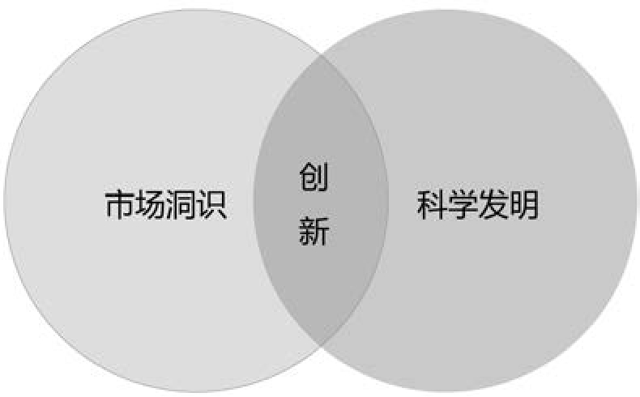

## 10.2　创新那点事儿

在我们看来，这些产品（太阳能电动车、苹果的牛顿PDA、Segway电动车）充其量只能算是发明，称不上创新，因为它们没有找到合适的目标客户群。发明仅仅是创造出新技术、新产品，而创新应该是发明（无论新旧）与市场需求的结合，或者说创新是科学发明和市场洞识的交集。

——《有的放矢》

创新需要满足两个条件：市场有需求，技术能实现。如果不能满足实际的市场需求，就只是发明了一个新奇的玩具，虽然有趣，最终只能被束之高阁。同样的道理，如果不能与科学发明相结合，纯粹的市场洞识带来的最好结果也不过是模仿别人的生意。关于创新的定义，可参见图10-5。

创新也必须克服两个风险。一是市场风险，即能否找到用户；二是技术风险，即能否做出来。不同行业创新的风险不同。比如，一提到医疗行业，就会瞬间想到治疗高血压、癌症、艾滋病等很多市场潜力巨大的特效药，但这些药很难研制出来。而我们所在的互联网、IT行业，做不出来的情况相对较少，更大的风险是找不到用户需求场景。

既然产品经理、创业者是最具创新能力的群体，下面就来聊聊创新。

{ width="332" height="204" }

图10-5　创新的定义

