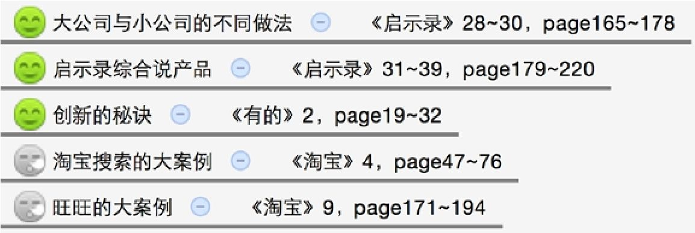
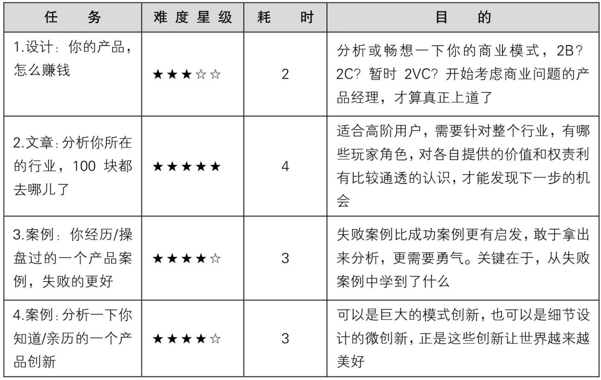
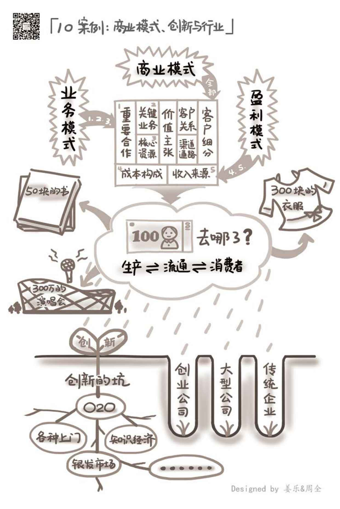

## 10.4　延伸阅读与练习

本章关联到另外几本书的相关章节如下。其中的图标表示推荐阅读（笑脸）与选择阅读（冷漠脸），亦可根据一些关键词扩展阅读。

<figure markdown="1">

{ width="485" height="162" }

</figure>

可以做的练习任务如下。

<figure markdown="1">

{ width="619" height="389" }

</figure>

<figure markdown="1">

{ width="634" height="951" }

</figure>

---

[[1]](../01/index.md#footnote_quote_txt011_1)
推荐阅读《用户力》第5章，对盈利模式的讲述得非常简单明了。

[[2]](../01/index.md#footnote_quote_txt011_2)
to Venture Capital（风险投资），业内对一些不赚钱公司的盈利模式的戏称，对比2B和2C的赚钱方式，说他们是赚投资人的钱。而投资人看重的则是公司未来的发展，愿意用钱来换取公司股权。

[[3]](../02/index.md#footnote_quote_txt011_3)
热寂理论（Heat death）是猜想宇宙终极命运的一种假说。根据热力学第二定律，作为一个“孤立”的系统，宇宙的熵会随着时间的流逝而增加，由有序发展为无序。当宇宙的熵达到最大值时，宇宙中的其他有效能量已经全数转化为热能，所有物质达到热平衡。

[[4]](../02/index.md#footnote_quote_txt011_4)
前喻文化是指用以前的文化、思维来影响今天，用过去的经验来决策现在，这在变化很慢的社会里很有效，是一种“儿子”向“老子”学习的文化。后喻文化是指向年轻人学习，向新科学、新技术和新生事物学习，是一种“老子”向“儿子”学习的文化。基于农耕文明的中国传统思想是典型的前喻文化，对创新非常不利。

[[5]](../02/index.md#footnote_quote_txt011_5)
二次元术语，指有人说了某些话或做了某些事之后必然会出现的决定剧情走向或事件发展的桥段。

[[6]](../02/index.md#footnote_quote_txt011_6)
作者克莱顿•克里斯坦森，是哈佛商学院教授，因其在企业创新方面的深入研究和独到见解，被尊称为“创新大师”。我个人非常喜欢这本书，特别推荐给在大公司里工作多年的人。

[[7]](../02/index.md#footnote_quote_txt011_7)
前Google、腾讯高管，现硅谷投资人吴军博士的书，讲述了近百年来IT产业一浪又一浪的发展与变革。

[[8]](../03/index.md#footnote_quote_txt011_8)
读者可扫描右侧二维码阅读原文。

[[9]](../03/index.md#footnote_quote_txt011_9)
读者可扫描右侧二维码阅读原文（此回答阅读前需要先登录知乎账号）。

[[10]](../03/index.md#footnote_quote_txt011_10)
这篇文章的作者是我的师弟方惠，我给了一些修改建议，感兴趣的读者可以扫描右侧二维码进行阅读。

