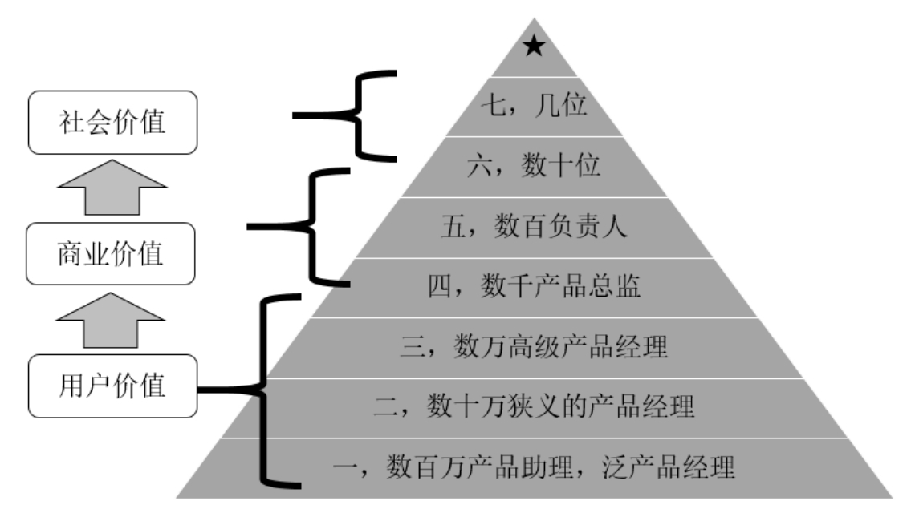

## 11.2.8 　七层里的三个阶段

七层讲完了，大家可以对照一下自己到了哪一层，参见图11-2。需要说明的是，你可能不是100%属于某一层，而是某一层为主，其他几层也沾了点边。仔细思考一下自己每天工作时间的分配，基本就可以做出判断。

产品经理的常见成长路径，是从大公司的基层做起，直到成为独立业务的负责人，中途任何时候都可以出去成为创业者，或者去中小公司当产品负责人。当然，如果个人足够强，从小公司起步是更快的做法。只不过，对大多数人来说，还是应该找机会去大公司练一些技能点。转行对产品经理来说也很常见，转进和转出的岗位都是五花八门，但通常发生在前三层，从第四层开始，产品经理就已经是比较综合的业务负责人了。

{ width="477" height="271" }

图11-2　产品经理的七层级与三阶段

产品经理的竞争很激烈，基本上升一层，人数就少一个数量级。行业内有数千万可能入行的学生和其他职场人士，不妨把他们叫作第零层的产品经理；在他们上面，有数百万的第一层产品经理——产品助理，这一层也包括了不少顶着其他岗位Title，做着初级产品工作的“泛产品经理”；其上依次是数十万的第二层——狭义的产品经理；数万的第三层——大公司里的高级产品经理或者创业公司的产品负责人；数千的第四层——大公司的产品总监或者中小公司的产品负责人；数百位的第五层——大公司的产品负责人，或优秀的创业者；数十位的第六层——大公司的总负责人、CEO；以及个位数的第七层——伟大的企业家。

这七层，又可以分为三个阶段的产品经理，分别对应着各阶段能创造的价值——用户价值、商业价值、社会价值。

►第一阶段主要是前三层的产品经理，最多包含部分第四层，其价值是用户价值，做有用的东西。比如，上世纪90年代很多国内的独立软件开发者，抱有一颗公益之心，可以不要收入，纯凭着兴趣做事；又如，大多数公司里，不考虑盈利问题的一线产品经理。

►你想继续发展，必须要有一支团队，而团队就需要有一定的资金支持，你不可能要求每个人都有公益之心。毕竟都是凡人，要养家糊口，所有的梦想都要建立在一定的经济基础之上。当你进入第二阶段，就要开始创造商业价值，就要开始给别人发工资了。而做一件对用户有用且能养活公司的事情，难度显然大了许多。关于赚钱，短期可以靠投资人，长期必须自己造血，这是部分第四层和五、六层的产品经理要考虑的事。

►赚到钱后，就自然而然地想讲点情怀，希望养活公司的同时还能解决一些人类共同的问题。你想创造社会价值，比如促进就业、布道普世价值观、激发大家的环保意愿，想把自己的公司从成功做到伟大，这是部分第六层和第七层的产品经理该有的想法。

最后来点实在的，这三个阶段的产品经理，分别能拿多少年薪？一个老同事持这样的观点：

作为一个产品经理，第一阶段叫理性决定下限，要面对的是目标、逻辑和解法。因为是术的层面，可以通过训练达到。全部做到，可以保证工资不会太低，但年薪最多50万（以2016年为例）。

第二阶段叫感性决定上限，要做到“向内看，独一无二”，年薪80万起步，并且有不少上升空间。

第三阶段叫人性空间无限，讲求“通过内心看到宇宙”，年收入几百万轻轻松松。

