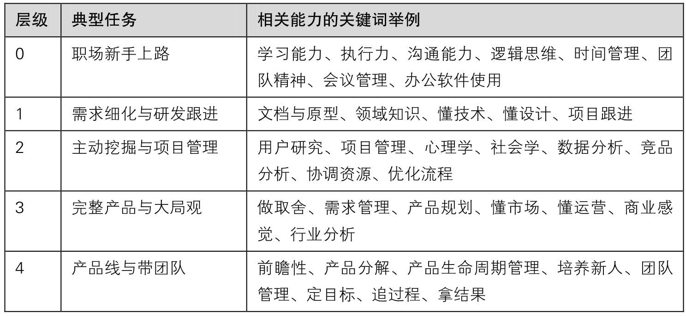
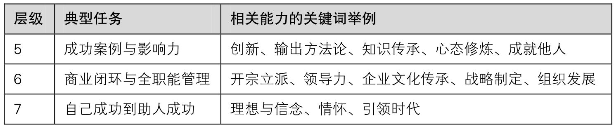

## 11.2　产品经理的七层修炼

要做产品，入行之前就要想想自己有没有本书第01章讲的思维方式与性格特点，以及一些基础素质，比如**学习能力、执行力、沟通能力、逻辑思维、时间管理、会议管理、办公软件使用**
等，然后再参照表11-1一步步修炼。

安排这一节内容的初衷是，想让大家看看自己到底走到了哪一步，想到达下一步需要做到哪些关键的提升。个人认为，初级产品的技能将被越来越多的人，甚至是非产品经理掌握，所以至少要走到第四层，才算到了一个相对安全的位置。

表11-1　产品经理的七层修炼

{ width="619" height="282" }

续表

{ width="619" height="124" }

