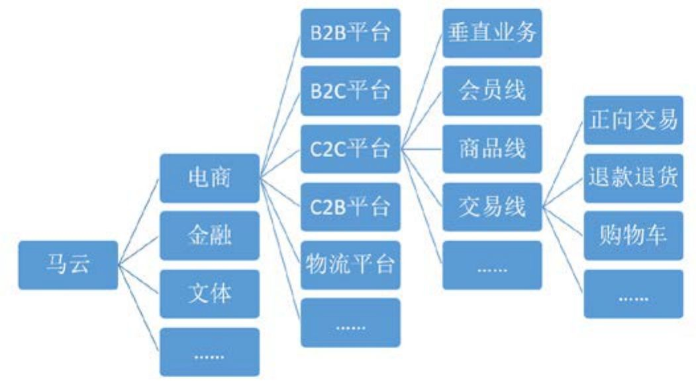

## 11.2　产品经理的七层修炼

要做产品，入行之前就要想想自己有没有本书第01章讲的思维方式与性格特点，以及一些基础素质，比如**学习能力、执行力、沟通能力、逻辑思维、时间管理、会议管理、办公软件使用**
等，然后再参照表11-1一步步修炼。

安排这一节内容的初衷是，想让大家看看自己到底走到了哪一步，想到达下一步需要做到哪些关键的提升。个人认为，初级产品的技能将被越来越多的人，甚至是非产品经理掌握，所以至少要走到第四层，才算到了一个相对安全的位置。

<figure markdown="1">

<figcaption markdown="span" style="margin:0.5em auto;font-size:0.8em;font-style:normal;line-height:1.5">
表11-1　产品经理的七层修炼
</figcaption>

{ width="619" height="282" }

</figure>

<figure markdown="1">

<figcaption markdown="span" style="margin:0.5em auto;font-size:0.8em;font-style:normal;line-height:1.5">
续表
</figcaption>

{ width="619" height="124" }

</figure>

### 11.2.1 　第一层，需求细化与研发跟进

如果你每天的工作都是写PRD、画原型、做Demo的话，那基本就是刚刚入门。你接到的是一个相对明确的任务，要能听懂，所以需要不少领域知识；要产出给技术人员看的需求文档，所以要懂点技术；要制作给设计人员看的原型，所以要懂点设计，这都是入门的基本功。

接下来，你会觉得自己有点像一个监工，在项目过程中负责盯需求对应的功能是否按时开发、测试、发布上线，这很考验“催功”。这个阶段，有三招是必须学会的，如果你已经在带新人，不妨学会后再传授给他。

这三招，一是**做客服**
，二是**写**
TC（test case，测试用例，是测试人员编写的用来指导测试执行的文档），三是**请吃饭**
，分别对应着**熟悉用户**
、**熟悉产品**
、**熟悉团队**
这三种目标能力。

**做客服**

做客服是为了真正了解目标用户是谁，他们的需求场景是什么。

原来阿里B2B的某个团队，只要是新招来的产品经理，必须先去客服部门轮岗三个月。这段时间做下来，每个新人都会很清楚现在产品的用户都是一些什么人，哪里让用户不爽，哪些改进点重要，哪些不重要……这种感同身受，是看再多的客服反馈报告也体会不到的。当然，轮岗三个月的做法，只有在公司资源很丰富的时候才可以施行。

如果做不到轮岗（哪怕一周），也有简单一点的做法，比如去听客服电话，浏览、回复客户反馈，只要每天下班旁听2、3个小时，多看看客服妹子的白眼，坚持几周，就会不一样。

我的孵化器里有一个做夜店社交的团队，我给他们的建议只有一句话：团队每个人，每周必须去泡一次夜店。

**写TC**

写TC是要真正了解产品的各种细节，以及每一条逻辑规则，顺带着了解技术。

TC可以理解成是从测试的视角写的产品描述。测试人员与产品经理的逻辑不同，产品要抓大放小，测试要想清楚各种边边角角。

如果团队正好没有TC文档，你可以来写一遍，很快就可以对产品的各种细节了如指掌，比如每一个模块背后用到了哪些技术，有什么之前为了某种妥协而埋下的坑。如果团队已有TC，你可以仔细阅读一遍，绝对比读产品文档更能了解细节，读的同时跟着做一遍测试，可以更快速地熟悉产品。

设想一个场景，某次需求评审会上，当讨论到某个细节时，大家都记不清了，只有你能脱口而出，绝对能让众人对你的信任度大大增加。

**请吃饭**

请吃饭是为了真正了解所有要合作的人都是什么性格，有什么喜好，甚至最近开心不开心。

产品经理的时间经常不够用，用来一个人吃饭太奢侈。一定要找人一起吃饭，技术、设计、市场、运营都可以，胆子大也可以拉老板一起，只要不是一个人就好。

我们算一下，一周工作5天，5顿午饭，5顿晚饭（基本上，干这行的很难不在公司吃晚饭），每顿和不同的人一起吃，一个月就可以认识30多人。这样吃下来，工作中经常有交集的同事，几乎都有了非工作场景下、非正式的沟通。

很多时候，你找技术提一个需求，他回答“做不了”、“没空做”，还是“我想想怎么办”，只取决于你和他熟不熟，这是真的。

类似地，如果你是烟民，可以约同事一起抽烟；如果你是运动爱好者，可以和同事一起打球、爬山……在良好的文化氛围下，做朋友与做事，可以相互促进。

最后，不要忘了问他一句：作为一个产品新人，现在没人带我，我应该怎么做才能快速上手？

以上三招，虽然又笨又花时间，但胜在简单有效，能帮你快速跨越第一层。悟性好的同学，三到六个月就能进入第二层，最慢的一两年总够了。

### 11.2.2 　第二层，主动挖掘与项目管理

**第二层与第一层的产品经理相比，最大的区别就是开始从被动变为主动。**

你开始自己去见用户、挖需求、探究人性，并把需求转化为产品功能，而这需要对用户研究、数据分析、竞品分析、心理学、社会学等知识有所掌握。你不再是一个在项目中盯需求的人，你开始主动发起项目，可能要承担项目管理的职责。这时候，抢资源就变成了一个很重要的能力，如果你在第一层时就和所有人结下了深厚的友谊，抢资源就会比较容易。

从下面一些小迹象就能看出你有没有迈入第二层。

►如果你负责的都是同事给的二手需求，那么你是第一层的产品经理；如果你经常亲自接触产品的用户，直接获取需求，那你就是第二层的人。

►开会的时候，如果你总是作为参与者接受会议邀请，那么你还是第一层的人；如果你经常作为组织者发送会议邀请，那就是第二层的人。

►如果你一直在按流程办事，按模板写文档，那么你是第一层的人；如果你开始优化流程，更新模板，那么你就是第二层的人。

进入第二层，你对公司各方面的熟悉程度大大增加，话语权明显提升。比如，你觉得随着团队变大，产品越来越复杂，现有的项目流程已经不适合现状了，就要有能力发起一个讨论，说服大家在“功能评审”与“发布”之间加一个“预发布”环节，在“需求评审”之后加一个视情况而定的“设计评审”环节。

回忆一下第05章说的Y模型，第一层的产品经理是被动的，前期的工作已经由老板想清楚了，要做的是“2”到“3”的How部分。而进入第二层后，就开始做完整的“1”到“2”再到“3”，甚至可以尝试去挖一挖“4”。

从能力角度看，第一层的产品经理只要有理性就能做好，而第二层需要增加一些感性方面的能力。做好Y模型的前半段，需要洞察用户、有人文情怀，做好后半段，需要有逻辑能力和科学素养。所以，我一直坚信“有人文情怀的理科生，或有科学素养的文科生”是最好的产品经理苗子。

第二层，也可以在一两年内跨越。所以，对于悟性比较好的新人，工作2年左右就可以开始负责一个完整的产品了。

### 11.2.3 　第三层，完整产品与大局观

前两层的产品经理，都还在做加法。而到了第三层，又会碰到这个金句：**完美，不是无一分可增，而是无一分可减。**
要开始做取舍、砍需求，大到产品概念的筛选，小到具体功能的权衡，都要有这个意识。

第二层的产品经理，可能负责产品里的一个模块或者功能，到了第三层，就要负责完整产品了，这意味着你负责的产品是一个可以提供用户价值的整体。

举个例子，第二层的你可能负责滴滴打车里面的一个模块，叫“我的”，里面有登录注册、我的积分、我的账户、我的行程、设置之类的功能。这时，你的心态是抢资源，要保证自己一亩三分地的产量。而第三层的你，开始负责整个打车的乘客端App了。这时候，你首先要考虑是这个产品不要做什么。因为资源有限，你会想更多“需求管理”、“资源分配”、“性价比”相关的问题。

因为要提供完整的用户价值，所以从这一层开始，对产品经理的大局观提出了要求，而大局观又分为时间和空间两种。

**时间大局观，是指规划与迭代。**

你需要开始考虑整个产品的发展节奏，1.0版本还没发布时，你就要确定1.1要做什么事情，规划1.2到2.0版本要往什么方向发展。这背后需要的是对市场、行业有比较深刻的认识，要有前瞻性和创新能力。分享一个培养时间大局观的办法：去各种应用商店，仔细研究那些明星产品的更新日志，比如微信、淘宝、支付宝，看它们从1.0到4.0、5.0，是怎样一步步发展过来的。有条件的话，可以去找对应产品的产品经理去验证你的猜测和想法，这样就更完美了。

**空间大局观，要借力周边团队。**

一方面，你要意识到，产品不仅仅只是个IT系统，还包括了线上线下的服务体验、与上下游的利益分配机制，等等。把产品狭义地理解成一个网站、一个App，正是新手产品经理最常见的误区，大多数人开始产品生涯时都会经历这个阶段。

另一方面，你要明白，产品的成功不是只靠产品经理，还有很多职能部门非常重要，比如市场、运营、服务等，甚至包括外部的合作伙伴。所以，你要开始恶补相关知识，做到能和他们平等对话，从而可以协调更多资源，或推动内外部团队去达成目标。毕竟，到了第三层，产品经理要对最终的用户价值，或者说一些商业结果负责，而不能再仅仅满足于把一些功能做出来或按时上线。

### 11.2.4 　第四层，产品线与带团队

第三层的产品经理，已经开始负责产品规划，关注生命周期，然后反向驱动市场和运营团队，也做过几次师兄师姐，可以算是老江湖了。再往下发展，进入第四层，主要区别就是负责的产品要足够复杂，要拥有洞察行业走势、提前布局的能力。这时，你光靠自己肯定忙不过来。

于是，你要**开始负责产品线，带团队，养新人**
。比如滴滴，一开始只有打车，解决司机乘客找到彼此的问题，随后你发现出行难还有车不够的原因，又开始做快车、专车，以提高车的数量。这时你又发现交通拥堵也是出行的大问题，需要提高车的利用率，顺风车、大巴等应运而生。

这个阶段，你要把一个大产品解构为几个子产品，交给几位产品经理，分而治之，而这些产品的集合，常常被叫作产品线。比如滴滴，先后推出的不同业务，就是不同的产品。而按照App或网站的产品形态来看，乘客端、司机端、平台端则又是一个分解维度。

通过[图11-1](#figure-11-1)，看看老马是怎么解构淘宝的。

<figure id="figure-11-1" tabindex="-1" markdown="1">

{ width="442" height="247" }

<figcaption markdown="span" style="margin:0.5em auto;font-size:0.8em;font-style:normal;line-height:1.5">
图11-1　马云眼中的阿里
</figcaption>

</figure>

首先，整个阿里现在已经不再只有电商业务了，还包括蚂蚁金服的金融板块（包含支付宝、蚂蚁聚宝、网上银行、芝麻信用等业务），以及双H战略（Health & Happiness，包含阿里音乐、阿里影业、阿里体育等业务）下的文体板块等。就其中的电商部分而言，B2B平台是最早的阿里巴巴，C2C平台是淘宝和AliExpress，B2C平台是天猫，C2B平台是聚划算，物流平台是菜鸟。

而仅是淘宝网站这一部分，又可以从很多维度来分为很多条产品线（[图11-1](#figure-11-1)已经做了很多简化）。淘宝有一个上百人之多的产品团队，非常考验如何细分产品，分不好自然会整天打架，即使分好了也要与时俱进、不断优化。

之后，你需要提升团队管理的能力，要能说服、能影响，要带着一群前三层的产品经理定目标、追过程、拿结果。这一层，你从对“物”，即事情的关注，上升到对“人+物”的关注。

### 11.2.5 　第五层，成功案例与影响力

单纯靠个人努力，可以达到的上限是第四层，我认为国内有数千人。而要有自己的成功案例，就需要额外具备天时地利人和，比如能赶上移动互联网的浪潮。

我说的成功案例，是指操盘过一个众所周知的产品，甚至是“无中生有”地做出了颠覆性的创新产品，而不只作为一名产品经理参与其中。到2016年，整个阿里的产品经理估计有2000人左右，但真正操盘钉钉、闲鱼、聚划算这样规模的产品的产品经理，也不过几十位，而其中能最终获得成功的更少。到了这一层，很难找到办法来教大家怎么一步步做出一个成功案例。其实绝大多数产品经理这一辈子都做不出一个成功的产品，就算是已经功成名就的，让他从零开始重新做，也不一定还能成功。这里的成功，是指产品不仅仅创造了用户价值，更获得了商业上的成功，即赚到钱了。

这一层对于培养新人的要求也会提高，要能输出方法论、做好知识传承、建立团队的人才梯度，并形成影响力。

影响力分公司内和业界，没法刻意提升，获得的途径一是拥有自己的成功案例，二是通过帮助别人，教学相长。作为一个做了三五年产品的人，总会有些心得体会、方法论，但自己懂和能教会别人，中间还有很大的跨度。到了这个阶段，我建议大家可以先为了自己做些总结记录，并且把这些内容分享、传播给更多的人，帮助大家一起成长。我通过这个办法，已经写了三本书。坚持做一段时间，就发现提升最大的其实是自己，而影响力只是一个副产品。

厚积才能薄发，机会只会给有准备的人，能达到这一层的人，国内也就数百人吧，已经算“大师”级别。这种人创业，走到A轮轻轻松松。从这一层开始，要开始心态的修炼，要有成就下属、同事、合作伙伴的胸怀，要能做到尽人事听天命。最后，送大家一个词——随缘。

### 11.2.6 　第六层，商业闭环与全职能管理

马化腾、雷军、周鸿祎都说自己是产品经理，你信吗？如果要算，他们至少是第六层的产品经理，已经是行业大佬，可以开宗立派了。做到这一层，各种岗位殊途同归，岗位是不是产品经理已经不重要了。

与第五层产品经理的主要区别是，你负责的领域从“产品的方方面面”发展为“商业闭环”，即在某个行业里，践行甚至开创某种商业模式，给行业带来惊喜，影响浪潮。负责商业闭环，意味着你要开始考虑赚钱的事情，考虑如何养活几百几千人团队的问题。这时候，你已经是一个独立公司，或者大集团里子公司的总负责人，即我们常说的CEO。除了战略，还要开始思考企业文化的事情，需要极强的领导力和组织建设能力，要带领一个全职能团队冲锋陷阵。

为什么大公司里的产品经理，做了几年之后都喜欢出去创业？因为他已经能看到商业的全貌，但分工使然，他在团队里并不能决定所有事情，身边还会有市场总监和一个销售总监等掣肘，业务的成功与否不完全受自己控制，有时会非常纠结。而大公司里，从产品总监升职为事业部总经理的机会少之又少，同台竞争的是所有其他职能的负责人。于是出去创业、自己操盘成为了一种不错的选择。

**在第六层，你的关注领域会从“人+物”，上升到“人+财+物”。多的这个“财”，指的是创造收入、获得盈利。在同行眼中，你已经是一个精神导师了。这时候，你也需要开始考虑产品和公司的国际化，去影响更大范围的人群。**

讲到第六层，都已经把世界互联网大会上发言的那波人都扯进来了，国内不过数十位，那第七层是什么？

### 11.2.7 　第七层，自己成功到助人成功

第七层的产品经理，需要从自己成功发展到助人成功，从商业过渡到人性，要加入一点情怀，力争能对社会甚至人类文明有贡献，能开创一个时代。从商业上看，这样的事情几乎也是开创了一个全新的行业，引领浪潮并站在了浪潮之巅。

做这种广义的产品，需要强大的理想和信念做支撑，因为它是一辈子都做不完的事情。它不是一个产品实体，而是一种理念，可以让世界更美好。这种产品会以平台的形态出现，不仅仅可以赚钱、养活团队，还可以帮助到社会上的很多人，这是比商业价值更高的社会价值。

比如阿里，促进了商业文明的进化，养活了数千万人，包括淘宝上的卖家，以及服务卖家的客服，还有不计其数的快递员，等等。又如Google，促进了全球信息化的进程，让很多贫穷的人也能和富人一样平等地接触各种知识信息。再如还在高速成长中的滴滴，正在变革着我们出行的方式，已经让数百万人可以通过开车养活自己。

想达到第七层，需要你彻底想清楚自己做各种事情的初心，拥有关注全人类命运的人文情怀，这样才有可能找到自己改变世界的方式。我在这方面尝试着做的一点点微小的努力，可以总结成几句话：

好产品改变世界，

产品经理改变产品，

我们来改变产品经理。

加个放大器：人人都是产品经理。

### 11.2.8 　七层里的三个阶段

七层讲完了，大家可以对照一下自己到了哪一层，参见[图11-2](#figure-11-2)。需要说明的是，你可能不是100%属于某一层，而是某一层为主，其他几层也沾了点边。仔细思考一下自己每天工作时间的分配，基本就可以做出判断。

产品经理的常见成长路径，是从大公司的基层做起，直到成为独立业务的负责人，中途任何时候都可以出去成为创业者，或者去中小公司当产品负责人。当然，如果个人足够强，从小公司起步是更快的做法。只不过，对大多数人来说，还是应该找机会去大公司练一些技能点。转行对产品经理来说也很常见，转进和转出的岗位都是五花八门，但通常发生在前三层，从第四层开始，产品经理就已经是比较综合的业务负责人了。

<figure id="figure-11-2" tabindex="-1" markdown="1">

{ width="477" height="271" }

<figcaption markdown="span" style="margin:0.5em auto;font-size:0.8em;font-style:normal;line-height:1.5">
图11-2　产品经理的七层级与三阶段
</figcaption>

</figure>

产品经理的竞争很激烈，基本上升一层，人数就少一个数量级。行业内有数千万可能入行的学生和其他职场人士，不妨把他们叫作第零层的产品经理；在他们上面，有数百万的第一层产品经理——产品助理，这一层也包括了不少顶着其他岗位Title，做着初级产品工作的“泛产品经理”；其上依次是数十万的第二层——狭义的产品经理；数万的第三层——大公司里的高级产品经理或者创业公司的产品负责人；数千的第四层——大公司的产品总监或者中小公司的产品负责人；数百位的第五层——大公司的产品负责人，或优秀的创业者；数十位的第六层——大公司的总负责人、CEO；以及个位数的第七层——伟大的企业家。

这七层，又可以分为三个阶段的产品经理，分别对应着各阶段能创造的价值——用户价值、商业价值、社会价值。

►第一阶段主要是前三层的产品经理，最多包含部分第四层，其价值是用户价值，做有用的东西。比如，上世纪90年代很多国内的独立软件开发者，抱有一颗公益之心，可以不要收入，纯凭着兴趣做事；又如，大多数公司里，不考虑盈利问题的一线产品经理。

►你想继续发展，必须要有一支团队，而团队就需要有一定的资金支持，你不可能要求每个人都有公益之心。毕竟都是凡人，要养家糊口，所有的梦想都要建立在一定的经济基础之上。当你进入第二阶段，就要开始创造商业价值，就要开始给别人发工资了。而做一件对用户有用且能养活公司的事情，难度显然大了许多。关于赚钱，短期可以靠投资人，长期必须自己造血，这是部分第四层和五、六层的产品经理要考虑的事。

►赚到钱后，就自然而然地想讲点情怀，希望养活公司的同时还能解决一些人类共同的问题。你想创造社会价值，比如促进就业、布道普世价值观、激发大家的环保意愿，想把自己的公司从成功做到伟大，这是部分第六层和第七层的产品经理该有的想法。

最后来点实在的，这三个阶段的产品经理，分别能拿多少年薪？一个老同事持这样的观点：

作为一个产品经理，第一阶段叫理性决定下限，要面对的是目标、逻辑和解法。因为是术的层面，可以通过训练达到。全部做到，可以保证工资不会太低，但年薪最多50万（以2016年为例）。

第二阶段叫感性决定上限，要做到“向内看，独一无二”，年薪80万起步，并且有不少上升空间。

第三阶段叫人性空间无限，讲求“通过内心看到宇宙”，年收入几百万轻轻松松。

