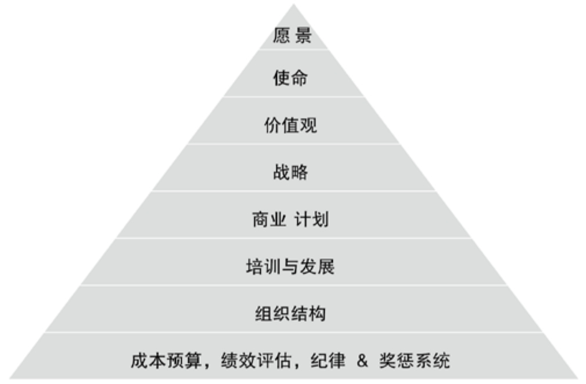

## 11.4　归宿：无非广义创业

本书快结束了，你的职业生涯还要继续，你总会碰到这个问题：如果有一天，不做产品经理（这个岗位）了，还能做什么？

我的答案是“创业”。当然，这里说的是广义的创业，是对自己可调配的资源进行优化整合，从而创造出更大价值的过程。接下来，就聊聊大家的归宿。

### 11.4.1 　从产品经理到创业者

乔布斯说过一句话，大意是：**过去学过的东西、做过的事，总会在不经意的时候，对你现在做的事情有用，时间长了，你会发现没有任何一段时间是白费的**
。

我也认为，每一次新的开始，都是过去所有积累的一次变现。但这其实需要用心设计，我自己就是有意在寻找一条能把过往的经历都用上的路，或者说，先想好将来要做什么，然后去积累一段段的经历为之准备。2014年底，我自认为找到了一条比较好的线路——从产品经理到创业者。

因为这两个角色本身就是二位一体的。

每一个产品经理，都是潜伏在公司里的创业者，因为没有可并肩创业的投入，是做不好产品的。在大公司里工作，就像是在温室里锻炼创业需要的技能，比较安全。而产品岗位的思维训练，会让产品经理越来越有自己的想法，而这个想法和公司的大方向正好吻合的概率实在太低了。所以，很多人会自然而然地选择创业。

每家公司的创始人，也必然是公司的第一任产品经理，创业的想法总是创始人自己想出来的，他要思考“要做什么事，来解决什么人的什么问题”，就必须具备产品经理的能力。

于是，我在2014年下半年离开阿里集团，成为了一名创业者。有趣的是，我的创业方向是“创业服务”，继续服务着产品经理和创业者。我和一些小伙伴一直在做产品方面的培训、咨询工作，看过大量的案例，也发现了很多创业者在辛苦地做着毫无意义的事情。

给大家看一段《有的放矢》里我很喜欢的话：

很多大家熟知的“做产品”的过程，是过去几百上千年，长期物质缺乏而推导出的“供给驱动”模式。最近几年，“需求驱动”的模式日渐上风，而我们还不习惯。供给驱动模式，在现今只适合成熟的产品，属于执行过程，而创业是探索过程，需要的是试错、迭代。

消费者是否愿意购买产品，并不取决于创业者是否勤勉，技术是否先进，或者销售人员是否有魅力。这也是大部分创业者失败的原因，并不是他们没能力开发产品，而是开发的产品用户不需要。

这段话说明，很多创业者都缺乏产品经理的能力。可是，我哪有能耐帮到这么多人，不要说个人水平不够，无法对各个行业都有了解，就是时间精力也不允许。所以，还是要借力团队。我现在有两家杭州的公司，良仓孵化器和B12，都是在做相关的创业服务，大家有兴趣可以扫码查看更多信息，见[图11-3](#figure-11-3)。

<figure id="figure-11-3" tabindex="-1" markdown="1">

{ width="341" height="128" }

<figcaption markdown="span" style="margin:0.5em auto;font-size:0.8em;font-style:normal;line-height:1.5">
图11-3　良仓孵化器和B12的二维码
</figcaption>

</figure>

创业太难了，千万不能脑子一热就跳进这个坑。接下来，我会和大家聊聊，决定创业之前要想清楚的一些事。

### 11.4.2 　体验创业的三种选择

创业很火，每个人都想投身进去试试。

其实，很多人并没有成型的想法用以发起一个项目，也没有足够的把握组建一个团队，而是想体验一下那种**闹哄哄的感觉、激情燃烧的岁月**
，特别是很多在大公司待久了觉得无聊的人。我和不少这样的人聊过，发现念头一旦产生，就很难再遏制。好在，就算想体验创业，你也有多种选择，只是每种选择需要的能力储备、心理建设完全不同。

以下说的创业公司，主要指A轮以前，整个公司最多不超过五十人，随时能看到、搭讪老板们的那种。

**第一种，当员工**

创业后，你会迅速地从不知道自己做不了什么，变成知道自己做不了什么，从而更认同团队的力量，更明确自己的定位。因为大公司分工明确，只要发挥长处就行了，没机会自曝其短，而在小公司，任何人都会被逼着做任何事情。想清楚自己的情况，别跳进去以后，才发现自己完全没准备好。

当员工，也可以体会到创业氛围，了解大公司和小公司做事的区别，丰富自己的职业履历，同时也可以给自己一个合法暴富（有股票期权）的机会。创业公司的每个员工都要独当一面，因为分工不明确，所以个人能力历练起来比较杂乱，但成长非常快。乱对能力强悍的人来说是好事，他们自己会通过总结梳理来找方向、找机会，但对于能力一般的人来说，就会陷入混乱，还不如在大公司按部就班地练级。

当员工，意味着有工资拿。而且现在的创业环境比较好，资金充裕，在创业公司当员工的固定收入通常也不会比大公司差太多，又不需要自己承担创业失败的风险。个人不认同为了创业降低家人的生活水平的做法（降低自己的，只要你愿意就可以）。所以，对有经济压力的人来说，当员工是体验创业的唯一选择。

**第二种，当合伙人**

所谓合伙人，是那种你愿意也敢于把所有坏消息都告诉他的人，通常，这种人都是认识多年的老朋友。至少拥有5%～10%的公司股权，才可能有合伙人心态。这时候，作为公司的拥有者之一，你要有更明确的创业者姿态，比如很多人是不拿工资或者只拿生活费的。

合伙人的认可，一定要是相互的。也就是说，如果有5个合伙人，那10个关系对中任一对的两人之间都要彼此认可。

要成为合伙人，一是要具备对公司长期发展而言不可替代的能力。如果只是短期内公司需要的关键能力，比如某种人脉、用户资源，完全可以用兼职顾问的方式来实现，说直白一点，用更少的股份或者现金做利益交换即可。二是个人职业路径要和公司做的事情吻合。这可以基于其过去多年做过的事情加以判断，而且合伙人必须非常认可公司的愿景，并且曾经为此愿景努力过。

**第三种，当老大**

老大也是合伙人之一，是股份最多的那位，通常也是这个创业项目的原始想法、初心的来源，必须有强烈的使命感——不做这件事，这辈子就白活了；做过这件事，就算失败了也是给自己一个交代。有了这种心态，团队在碰到各种问题时，才能坚持下去。

做老大需要有充分的心理准备，因为老大会有一种深深的孤独感，和做老二的感受是完全不一样的。公司里任何一个人，在搞不定问题时，都可以找个人问问：“我该怎么办”，到老大这里，没有人可问，只能自己扛。相信每个老大都有过深夜一个人陷入沉思，无处释放压力的经历。当然，也有解决方案，公司发展阶段相似的CEO们可以组成“兄弟会”，互相打气，出谋划策，但这只是安慰剂，并不能解决实际问题。

像CEO这种级别的老大，要做的事情除了业务本身外，还有很多如[图11-4](#figure-11-4)所示的文化与团队层面的事情，更要在外部为公司摇旗呐喊、融资……

<figure id="figure-11-4" tabindex="-1" markdown="1">

{ width="424" height="278" }

<figcaption markdown="span" style="margin:0.5em auto;font-size:0.8em;font-style:normal;line-height:1.5">
图11-4　CEO要搞定的事情
</figcaption>

</figure>

以上三种体验创业的选择，一种比一种难。因此，还是要再次提醒，开始之前务必多问问自己——准备好了吗？

### 11.4.3 　互联网创业的五个启动步骤

如果你真的打算开始作自己事业的创始人，那么在最开始的启动阶段，可以按照如下五个步骤来做。

**第一步，再次判断自己适不适合创业**

主要考虑以下这些前提条件。

►**同窗：**
多年来，你已经积累了一群兄弟，不管你干什么都愿意跟着你。这群人组成的整体能力是否完整，与要做的事情匹配度是否高。

►**无根：**
是不是没什么牵挂，可以全身心投入到创业中，比如可以说走就走地换城市。

►**无畏：**
创业过程中必定会碰到无数巨大的困难，面对困难时你是否有坚忍不拔的态度，能屡败屡战。

►**激情：**
你对做的事情是否有使命感，是否不做就觉得这辈子白活了。

诚然，我们身边的创业者，兼具这四点的不超过10%，但这些重要的加分项，只要已经下定决心，还是可以逐步向其靠拢的。只有顺理成章地解决了这些问题，创业才有可能成功。

**第二步，组队和选择合伙人**

主要基于以下的要素进行选择。

►**共同愿景：**
你们对做的事情要真心认可。所以，对靠谱的合伙人，既不能强拉说服，也不能用不合理的股份比例吸引。

►**背靠背的信任＋包容：**
可以分享所有消息，尤其是坏消息，因为这建立在对双方都已足够尽力的完全信任之上。

►**互补：**
性格和能力都要互补。而这要求创始人对要做的事情需要什么能力，应该有一个清晰的认识。与合伙人也要有明确分工，比如一个在外面冲锋，一个在内部管理；或是一个负责线下，一个负责线上。

**第三步，找到精准的商业模式**

与合伙人一起讨论切入点。好的模式通常都是能一句话说清楚的，比如可以用类比的方式来让对方更容易理解——中国的Airbnb、某某领域的滴滴打车……

**第四步，确定各自的权责利与股权结构**

根据商业模式和切入点，可以推导出要做什么事，以及需要哪些能力。然后分析初创团队里每个人的重要性，综合考虑短期与长期价值，据此推导出股权结构。通常，团队一定有暂时空缺的能力。对此，可以把部分股份做成期权池，留给将来加入团队的能人。

**第五步，打磨业务和产品**

广义的产品，即你的解决方案，在产品早期要注意以下几点。

►**产品心态：**
尽快做出一款丑陋的产品，不要追求完美，而要追求尽快验证。

►**产品迭代：**
每周树立一个里程碑，其本质是保持快速改进的节奏。

►**能否外包：**
创始人应该自己做第一任产品经理。产品设计层面绝对不能外包，技术实现在短期内可以外包应急，但要做好找到技术合伙人之后重做的准备。

走完这五步，之后就都是产品经理相对熟悉的领域。

### 11.4.4 　互联网创业的地域鄙视链

不管你是准备创业，还是已经在创业，都有必要给你说说这个政治不那么正确的话题。大家也有必要好好想一下，为什么很多投资人都喜欢问互联网创业者这个问题：

**你们团队在哪个城市？**

如果答案不是“北上广深杭”，那么他心里就已经给这个团队减了好多分，甚至希望在3分钟内结束聊天。

这是个“地图炮”的话题，我们尽量保证客观。

首先要理解，任何一个投资人都不能保证一个不漏地看全所有团队、人、项目和产品。当多到怎么看也看不完（这就是知名投资机构、资深投资人的现状）时，多数投资人都会基于概率论采取一些切分策略，即通过一些非常简单易判断的标准，把一部分项目砍掉，不在它们身上花时间。比如最简单的地域，核心团队成员里是否有互联网背景、知名公司背景，合伙人之间认识了多久，过去有没有做过与此相关的事情……

这样简单粗暴的做法，确实会错过个别潜力股，但符合概率，错过的毕竟只是特例。

那么，一个创业者从小地方来，到底错哪儿了？其实，与个人完全无关，全部错在环境。

一个城市能够成为创业之都，要具备多个要素，这是很多创投人士共同总结出来的。

►有足够多足够好的**创业公司**
来提供文化氛围、社会认同和资源流动性。

►有具备示范作用的**龙头企业**
，可以提供高素质的“熟练工”，比如创业公司的合伙人。

►有**投资公司与天使投资人**
，可以提供钱以及衍生资源。

►有**优质高校**
能提供高潜力新人和技术研发能力。

►当地**政府**
能提供政策支持和优质的大环境。

稍微修正一下这几个因素。

第一，在“双创”（大众创业、万众创新）的大背景下，政策已经是没有最好只有更好的状态。各地领导经常互相参观、学习，分分钟就可以将环境复制过来，所以这个因素的影响相对较小。

第二，“本地用户”是一个不可或缺的重要因素。如今的互联网创业，线下部分越来越多，本地用户的成熟度、对新事物的接受程度会起到很大作用。

举个简单的例子，2014年左右，杭州的街边已经可以随意使用支付宝了。在超市、小面馆，可以很自然地问老板是否接受支付宝，绝大多数的回答都是“可以”，甚至有的小老板在我发问之前就主动提起。这一点，北京当年就差一些，而到了县城，根本问不出口，只能老老实实用现金。

以上要素形成一个生态，一个互为因果的正循环，缺了任何一个都会对正反馈产生很大影响。接下来，综合评估一下国内几大创业城市。

►**北京：**
毫无疑问，帝都各种要素的分值爆棚，不是超出一点半点，而是几倍地碾压其他城市。但交通和环境不佳让很多人又爱又恨。另一方面，作为政治中心，它与创业者需要的创新、颠覆、叛逆、自下而上等文化有些冲突。这个影响，也许在几十年甚至更长的时间尺度上会体现出来。

►**杭州：**
偏电商与生活服务。阿里功不可没，不仅仅树立了一个标杆企业，而且还培养了很多阿里系的创业者和投资人，特别是土豪级的早期投资人。还有个自认全国第三的浙江大学，学生多，质量高。因为传统浙商及阿里系的原因，创业、创新氛围比较浓，而政府对新生事物的态度也相对开明。

►**深圳：**
略偏硬件，坐拥腾讯、华为、华强北等超级品牌。将深圳排在杭州之后，一是对一直生活、工作的城市有些偏爱，二是因为深圳缺少一流大学。当然，作为移民城市，离香港近，自然环境也极佳，所以对人才的吸引力同样很强。

►**上海：**
虽然现在体量大，但我不看好它的增速。外资、金融占据了太多上海的资源，但缺互联网巨头，缺创业氛围。可以对比美国的纽约与硅谷，就会觉得上海和其他创业城市相比，总是差一口气。或许什么时候陆家嘴不再看不起张江，上海就有希望了。

►**广州：**
一山难容二虎，总觉得被紧邻的深圳压着一头，甚至有继续下跌的风险。

我把国内有希望开展互联网创业的城市分为三档，每下降一档机会就会少很多，而如果不在这三档里，那成功的概率就真的很低了。唯一的第一档是北京，第二档是杭州、深圳、上海、广州，还有一批有潜力的第三档，下面简单列举一下。

►**南京：**
虽然好学校很多，但总觉得旧都的气质、浓浓的民国范儿和互联网创业不太搭，倒是离它不远的**苏州**
，挺有希望。

►**成都：**
偏游戏，倒是和这个城市的休闲风很配。中国西南地区那么大，总得有个根据地，毕竟很多人还是愿意离家近点。

►**西安、武汉：**
作为西北、中部最好的高校聚集城市，也有机会。

►**厦门：**
也是自然环境优秀的好地方，曾几何时，网络营销很厉害。

我们按照创业公司老大需要重点关注的三个问题：人、财、物，来看看如果你不在这些城市，会碰到什么问题。

►**人-团队：**
就算自己足够强，哪怕你是从北京回到三线城市，也会碰到招不到人的尴尬。因为这些人通常都在互联网巨头或者其他创业公司里，而不同级别高校学生的差距，不得不承认，真的巨大。于是，组成一个高质量团队的可能性大大降低。

►**财-资本：**
缺乏专业投资人，就算拿到钱，多半也是当地金主的钱，背后的资源比起一线投资人来说几乎可以忽略。举个简单的例子，知名天使投资人如果投了某个项目，媒体是会抢着报道的，这种放大效应、免费广告你就无法享受到了。

►**物-业务：**
因为身边的同行变少，当地用户的教育也更难，毕竟缺少一堆“友商”帮你分担教育重任。不在创业高地，视野会变窄，会使得你对最新动态的敏感度降低。常见的局面就是，自以为想到一个绝妙的点子，来到北京见了第一个投资人，对方问“你知道XX公司吗”，然后就没有然后了……

于是，作为一个小城创业者，也就只能被减分减分再减分。那么，如果你就是在这样的城市，该怎么办呢？

第一，之前说过创业者的一个加分项就是“无根”，可以为了创业换城市。如果你换了城市之后变得一穷二白，那也只能依托于长时间的积累，也必须接受的确落后于从大学阶段就开始积累的创业者的事实。

第二，利用不同级别城市的时间差来创业。多年前中国学美国，你现在可以学北京，但是做区域性的项目，需要安心赚钱和积累各种资源，同时少考虑模式创新。等过几年大公司下潜到你的城市时，看到你的项目现状，会觉得与其从头做起还不如直接收购你。

第三，分析清楚现状，好好上班。创业本来就只是一种选择，而且是Hard模式，对大多数人来说，并不是最优选择，入行需谨慎。

当然，上述对城市的评价只是2016年的一个时间切片，而且相当主观。时间会改变一切，只是没那么快。将近20年前马云开始做阿里巴巴时，杭州也只是一个小城市。

### 11.4.5 　下一个硅谷在哪里

上一节探讨了一家公司怎样才能成功，这一节把视野提升到一个地区如何成功的高度。

上面提到的那些城市，都说过要成为中国的硅谷。确实，说起互联网、创业创新，硅谷是毫无疑问的世界中心。硅谷不只引领了一次浪潮，而是最近几十年来的每一次浪潮，它都能站在浪潮之巅，从半导体、硬件、软件、互联网的发端，到生物、人工智能等黑科技的诞生，这才是它最厉害的地方。2016年，我入行十年，终于第一次去了硅谷，行程中特意读了吴军博士的《硅谷之谜》，并一直在思考，下一个硅谷到底在哪里。

**非决定性因素**

硅谷之所以成为硅谷，媒体经常提及的几个因素其实并不是决定性的，只能说是加分项，这一结论来自于对各种资料分析的研究和我的切身感受。

►**自然条件：**
这是指地理因素[[1]](../06/index.md#footnote_content_txt012_1)
。硅谷四季模糊，是典型的地中海气候，一年到头的温度、湿度都很宜居，类似气候条件的地中海地区孕育了文艺复兴。但工业革命的英国不是这种气候，各大文明古国也不是，南美、澳洲、非洲也都有小块地中海气候区域，并没见到什么成果。

►**优质高校**
：斯坦福和加州大学伯克利分校等，给区域输送了源源不断的高端人才。但这更像是结果，或者至少互为因果，而不是原因，毕竟美东波士顿地区也是牛校林立，有哈佛、MIT，等等。当然，高校背后的创新、研究能力及引领前沿的精神，的确是宝贵的，是一种必要条件。而产学研结合方面，硅谷做得也确实领先。

►**风险投资**
：资本作为一种资源，加上杠杆性很强，一直是硅谷的前进动力。而且，**KPCB**
和红杉等硅谷投资公司，与纽约华尔街资本的风险偏好完全不是一种风格。但是，风险投资与硅谷的形成同样是互为因果。

►**行业巨头**
：将其作为原因，更像是循环论证——巨头可能孕育新的巨头，也可能“大树之下，寸草不生”，陷入“创新者的窘境”而无法赶上下一个浪潮。比如底特律因汽车工业而生，也因此而死，中国东北的重工业也如出一辙。所以，似乎要有巨头，但也不能一家独大。

►**知识产权**
：它的确可以保护已经取得成就的创新者，但互联网精神从某种程度上讲，是有些“海盗精神”的，就是要无视知识产权，比如某些基于免费（甚至涉嫌盗版）的商业模式。

►**政策支持**
：这一点是国内“硅谷”的政府报告中很喜欢说的，但对美国来说真的不重要，因为美国的地方政府是典型的小政府，能做的极其有限。而且，如果政府的扶持让一些本来可以早死早超生的公司又坚持了几个月，也未必是好事。

**决定性因素**

曾经想过，BAT为什么分别出现在北京、杭州、深圳，和权力中心的距离正好是 0、1000、2000 公里。我的结论是，是文化潜移默化的影响在起作用，而这种影响最终表现在产品与用户的远近、对个体是否重视上。百度可以不注册就使用，不用知道你是谁，但技术驱动的中心化搜索，又能保证算法大权在握；阿里需要知道你是谁，依托各方利益交换形成商业模式，是一种运营驱动的“做生意”；腾讯不但知道你是谁，还要让个体之间互动，形成用共识来维护的集体社区，需要用产品来驱动。

那么，一个地区要成为硅谷，最本质的原因又是什么？同样是“文化”——创新文化，好奇心，人民群众是否乐于去探索、接受新鲜事物，等等。以下几点彼此促进，共同构成了硅谷形成的基因序列。

►**叛逆精神：**
不迷信权威，甚至以对抗权威为政治正确，而且多为“N+1”型叛逆，即在原来的基础上更上一层楼，而不是“N-1”型叛逆，比如简单重复、打价格战。在当前强势的公司的视角看，这不是什么好事，但站在更大的空间、更长的时间角度看，就是好事了[[2]](../06/index.md#footnote_content_txt012_2)
。资本也在暗地里支持有“反骨”的员工，而东家也体现出对叛逆的宽容，毕竟大家都是这样起家的。2011年，加州政府甚至会状告Apple、Google、Intel和Adobe四巨头互不挖人，因为这样不利于区域的活力。

►**拒绝平庸：**
建设性的叛逆（而不是破坏性的叛逆），对人的要求非常高。硅谷是一个只有精英才能存活的地方，越来越高的生活、工作成本，也在起着筛选的作用——挤走落后产业，迎接新贵。对创新赞赏、对抄袭鄙视的态度，构建了良好的社会共识，你在那儿copy别人要承受远超出我们想象的心理压力。个人的极客范儿、公司的扁平式管理应运而生，精英需要靠契约、共识做事，而不是强制。

►**宽容失败：**
再强的人，创新也经常面临失败。宽容不但是对失败宽容，还表现在开始时就做好失败的心理准备，认可快死比半死不活要好得多，所谓“死亡是一个公司对社会的最后一次贡献”，以及“淘汰掉不适合的人，对双方都是解脱”。在这种宽容下，风险资本、连续创业者才能愈挫愈勇。

►**多元文化：**
从淘金热开始，硅谷的每一代都是来自世界各地的移民，这让硅谷成为文化的大熔炉，极具多样性。移民的目标大多是要闯荡一番，更有冲劲，本来就和喜欢留守故土的人不同。彼此之间一旦没有“我是本地人，你是外地人”的疏离感，就容易形成多元文化，创新往往诞生于各种交叉、混合之中。因此，硅谷有了天然的全球化视野，世界大同的情怀。硅谷欧裔、亚裔、拉美裔等都很多，使其自然而然地成为世界的创新中心，而各族裔的创业者也只是将美国作为测试其全球产品的第一个市场。

那么，硅谷到底能不能长期引领全球科技？放在更大的时间尺度上，几大文明古国，中世纪文艺复兴的意大利，大航海时代的葡萄牙西班牙荷兰，以及工业革命的英国[[3]](../06/index.md#footnote_content_txt012_3)
，无不各领风骚上百甚至上千年，却也都没有长盛不衰。所以，更可能的情况是轮流坐庄。中国能否成为下一个庄家，离不开每位“泛产品经理”的努力。

