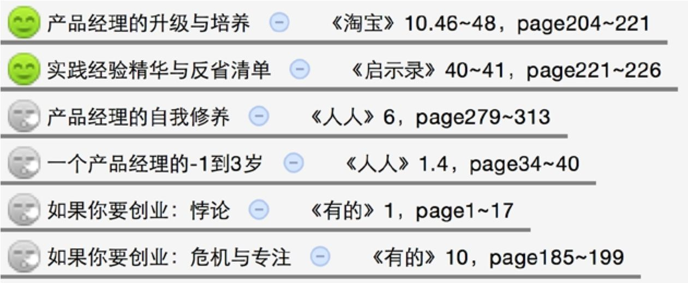
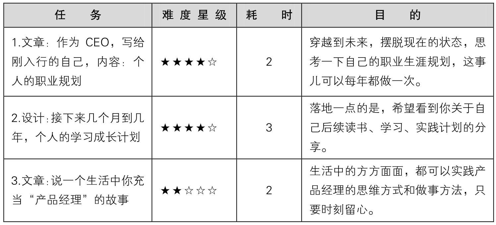
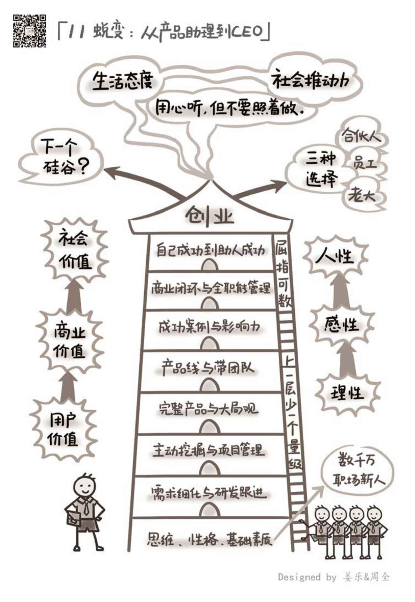

## 11.6　延伸阅读与练习

本章关联到另外几本书的相关章节如下。其中的图标表示推荐阅读（笑脸）与选择阅读（冷漠脸），亦可根据一些关键词扩展阅读。

<figure markdown="1">

{ width="530" height="218" }

</figure>

可以做的练习任务如下。

<figure markdown="1">

{ width="623" height="278" }

</figure>

<figure markdown="1">

{ width="634" height="922" }

</figure>

---

[[1]](../04/index.md#footnote_quote_txt012_1)
“地理决定论”一直是主流思想之一，可参见《枪炮病菌与钢铁》。

[[2]](../04/index.md#footnote_quote_txt012_2)
随着时空尺度的变化，因素的利害通常会随之发生变化。比如，你为负责的项目争取到资源，对部门是好事，但因其他资源有限而导致更重要的项目因此延期，对公司来说就是坏事；某地有丰富的煤炭资源，对短期发展是好事，但因为卖资源太容易赚钱而阻碍其他产业的发展，对长期发展就是坏事。

[[3]](../04/index.md#footnote_quote_txt012_3)
整体上看，在一个国家、地区是否能持续强大这个问题上，“大陆性”不如“海洋性”（这里的大陆、海洋不只是地理上的概念，更是文化上的概念）。海洋性开放、多样，更多与外部的交流、交易，能获得更多的“新”；大陆性自给自足，倾向于封闭，而一个封闭系统，在物理学上是熵增的，会走向混乱。

