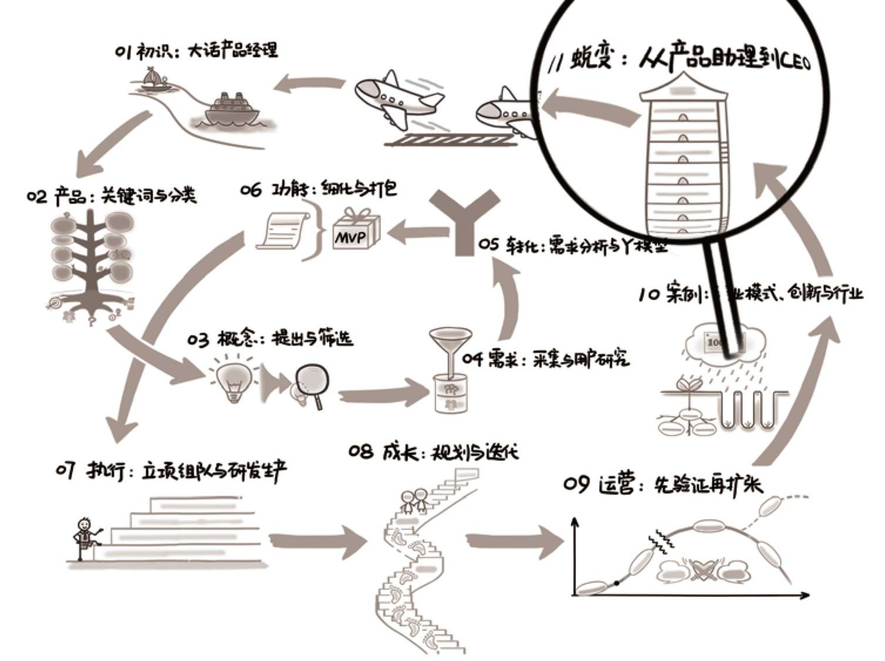

## 第11章　蜕变：从产品助理到CEO

{ width="634" height="473" }

**11.1　在人力资源部做产品经理/307**

**11.2　产品经理的七层修炼/307**

**11.2.1　第一层，需求细化与研发跟进/308**

11.2.2　第二层，主动挖掘与项目管理/309

11.2.3　第三层，完整产品与大局观/310

11.2.4　第四层，产品线与带团队/311

11.2.5　第五层，成功案例与影响力/313

11.2.6　第六层，商业闭环与全职能管理/313

11.2.7　第七层，自己成功到助人成功/314

11.2.8　七层里的三个阶段/315

11.3　十年后，再无产品经理/316

**11.4　归宿：无非广义创业/318**

**11.4.1　从产品经理到创业者/318**

11.4.2　体验创业的三种选择/320

11.4.3　互联网创业的5个启动步骤/322

11.4.4　互联网创业的地域鄙视链/323

11.4.5　下一个硅谷在哪里/326

**11.5　从生活态度到社会推动力/329**

11.5.1　先说生活态度/329

11.5.2　再说社会推动力/331

**11.6　延伸阅读与练习/332**

