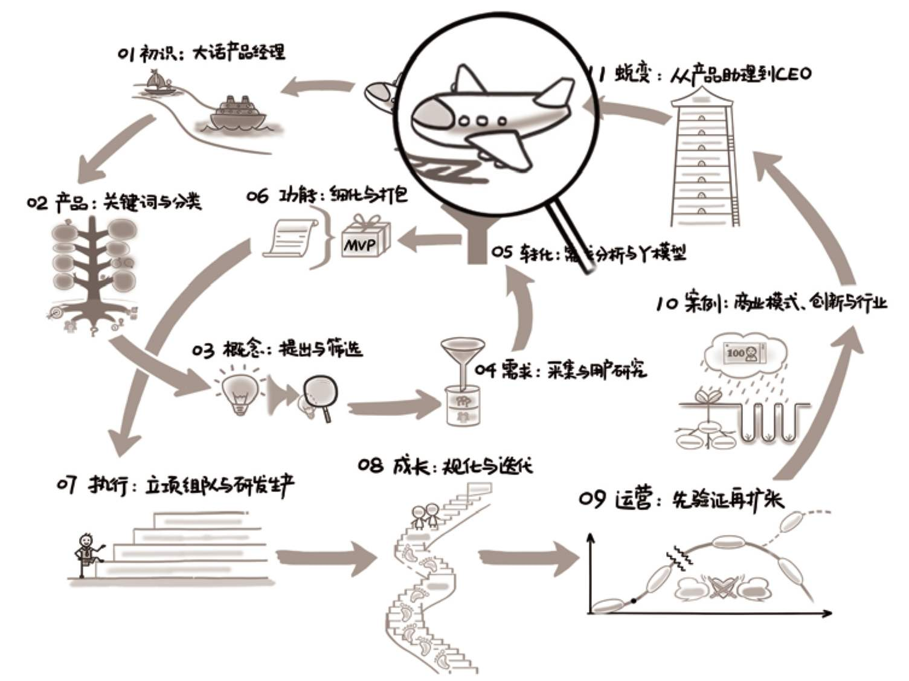

## 第12章　结束：写在正文之后

{ width="633" height="474" }

**第11章　蜕变：从产品助理到CEO/305**

**第12章　结束：写在正文之后/335**

**12.1　国产产品图书盘点/337**

**12.2　重新定义“读书会”/340**

12.3　七印部落翻译的书/342

12.3.1　打造用户喜爱产品的《启示录》/342

12.3.2　被严重低估的《四步创业法》/345

12.3.3　杜绝浪费，《有的放矢》/345

**12.4　其他资源/346**

12.4.1　一些组织的公众号/346

12.4.2　最近看过的一些杂书/348

12.4.3　一次众包本书索引的尝试/349

正文之后，罗列一些可能对大家有用的信息。

