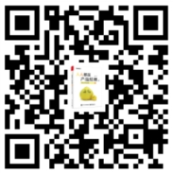

## 读者服务

轻松注册成为博文视点社区用户（www.broadview.com.cn），您即可享受以下服务。

**► 提交勘误：**
您对书中内容的修改意见可在【提交勘误】处提交，若被采纳，将获赠博文视点社区积分（在您购买电子书时，积分可用来抵扣相应金额）。

**► 交流互动：**
在页面下方【读者评论】处留下您的疑问或观点，与我们和其他读者一同学习交流。

页面入口：http://www.broadview.com.cn/3.1.0

<figure markdown="1">

{ width="104" height="104" }

</figure>

